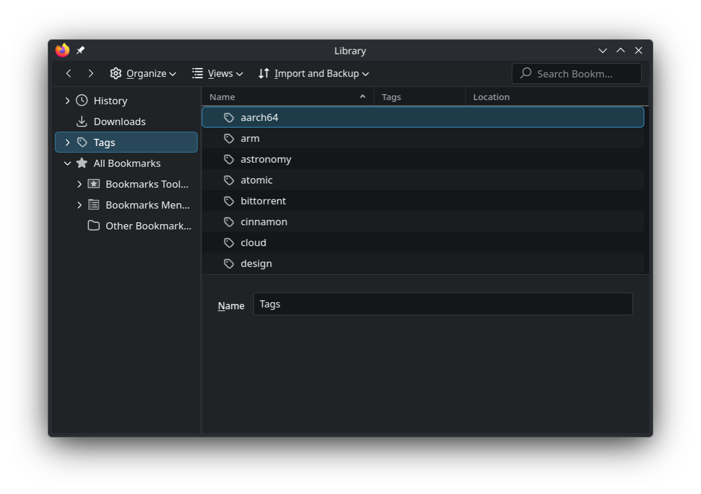
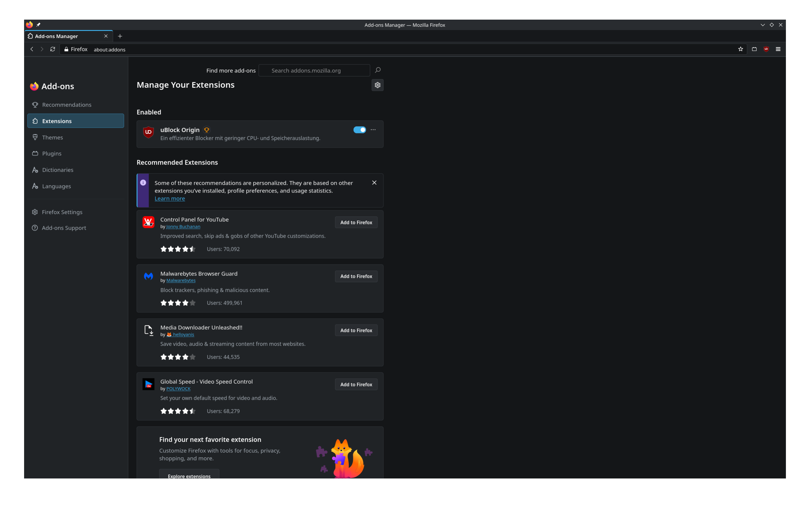
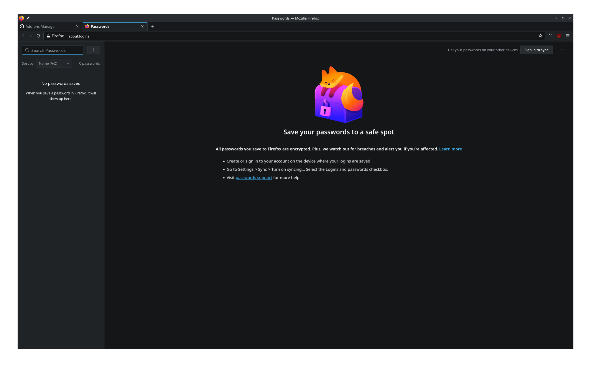
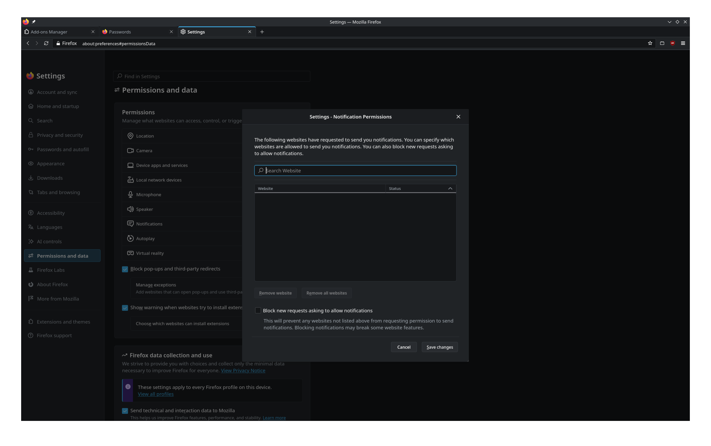
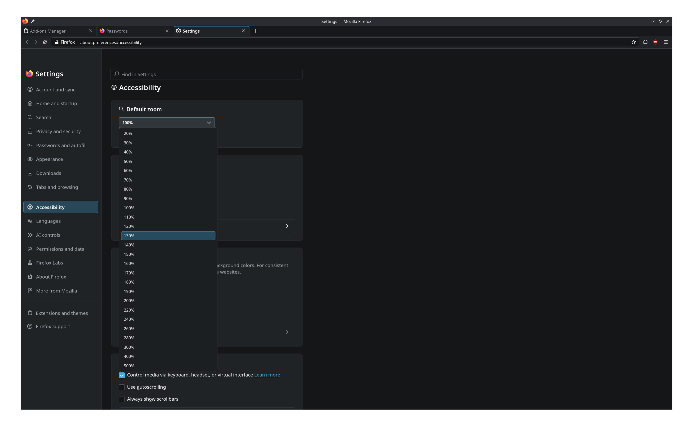
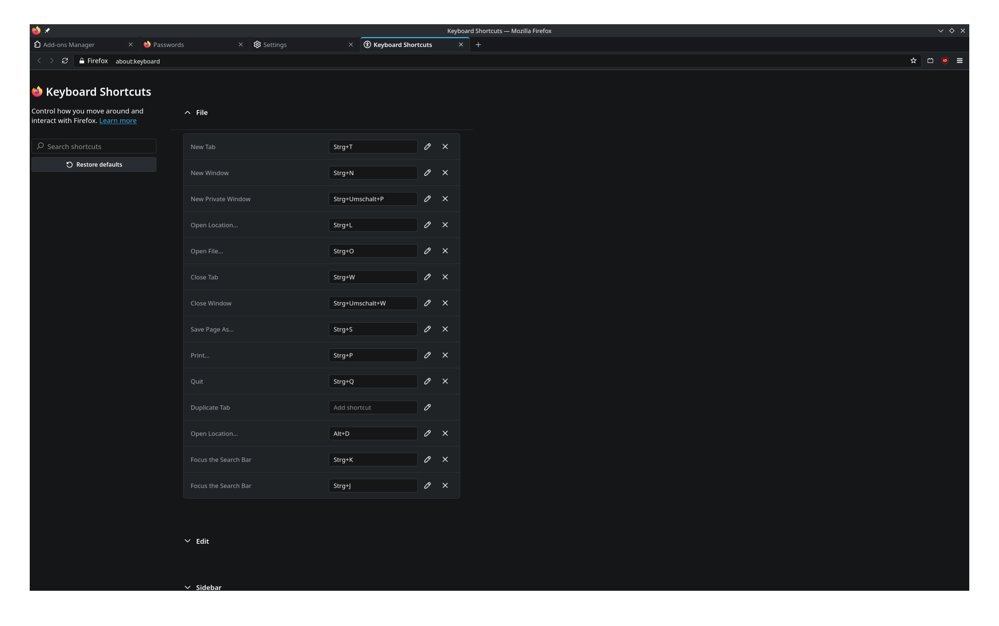
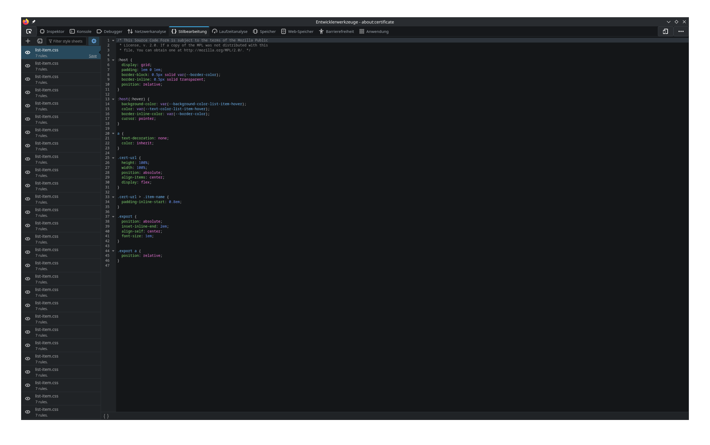

# Firefox-Breeze-Theme
A Breeze Theme for Firefox

How to install?
Download this repo as a zip, either put the stuff into your firefox profile folder or (for easier use) use the script (if you do not trust it, please read it, I will not provide some curl bullshit).

Limitations: 
Does not support wallpapers in new tab pages (I would recommend using an extension if you want animated stuff, gladly contribute if you wanna fix it)

Some pages like about:studies are not themed, most settings dialogs are though

Animations are uneven and not present everywhere they will be in later versions

This is an alpha release, though it works on Firefox 159 (lower version have not been tested)

The UX is not completely unified, the main goal was to unify the design though not e.g. padding between different components (contributions would be helpful)

[Main Preview](media/1.png)

<b>Click to view more screenshots (2–8)</b>

 

  
  

  
  

  
  

  

